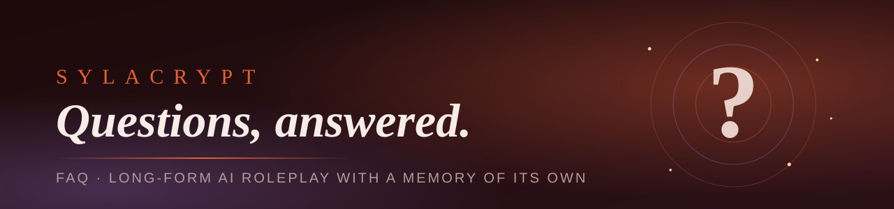

  

<b>The short answers to the most common questions about Sylacrypt.</b> 
Something missing? Ask on <a href="https://twitter.com/sylacrypt_org">X</a> and it may land here.

<h2> What is Sylacrypt?</h2>

Sylacrypt is a platform for roleplay with AI, in a chat format. It belongs to the same family as Character.AI and similar projects, but it is built around three things: a memory that doesn't lose the thread, a roleplay that doesn't cost a fortune, and an interface that is a pleasure to play in.

<h2> What is it for?</h2>

It solves three problems:

- **Memory.** Stories stay consistent even when they grow very long.
- **Cost.** Roleplaying with AI shouldn't be expensive.
- **Atmosphere.** The visuals make the game better: a customizable chat, highlights, animated backdrops, mood changes, music and more.

<h2> Where will Sylacrypt live?</h2>

Sylacrypt is being built as a **web service**, similar in format to Character.AI.

<h2> Which models will be used for roleplay?</h2>

Unlike Character.AI and similar services, Sylacrypt does not ship its own model. At the start you bring yours:

- with **your own API key** from a supported provider, or
- with a **local model** you connect yourself.

Later, a **subscription** will be available for people who don't want to deal with setup or settings. It is meant to let you play without limits.

<h2> How do I join the closed beta, and when does it start?</h2>

The date has not been set yet. Progress and announcements go to X: **[@Sylacrypt](https://twitter.com/sylacrypt_org)**. To hear about testing here, **Watch** this repository (Custom → Releases) or star it.
