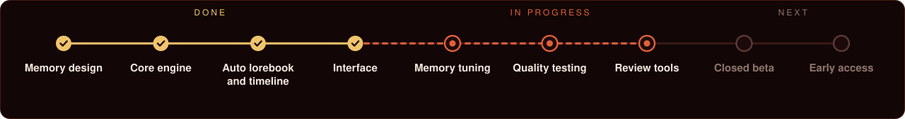

  

  
  
  
  

<b>Long-form AI roleplay with a memory of its own.</b>

> **Status: active development, preparing for closed testing.** There is no public build yet. This page is the project's public face: goals, progress and news. Sylacrypt is proprietary software; its source code and internal design are not public.

## The problem

Language models only see a limited window of text. Once a story outgrows it, the oldest parts are cut off or crudely summarized. The usual workarounds each have a cost:

- **Long context** is expensive, and models still lose details in the middle of it.
- **Manual notes and lorebooks** work, but you end up maintaining them instead of playing.
- **Automatic "memory" features** are usually a black box: you can't see what was stored, why, or fix it when it's wrong.

Sylacrypt aims at the middle path: automatic, but visible and correctable, and cheap enough to run on a modest plan.

## What it does

**A lorebook that fills itself.**
Characters, places, objects and organizations get cards with a category and structured fields. New cards are proposed as they appear in the story; you accept, rename or dismiss them. Everything stays editable.

**A timeline that keeps dates straight.**
Events are placed on your world's own calendar, so "a week later" and "three years ago" stay consistent across a long campaign.

**Relationships and state.**
Who knows whom, who trusts whom, what changed and when, including secrets that only some characters know.

**Context built to fit.**
Every request is assembled to fit your model's context window, and for each message you can see what the model was given and how much of the window it used.

## Designed for real-world limits

- **Bring your own key.** You use your own provider account, so you pay your provider directly and nothing is added on top.
- **One provider and one model are enough.** There is no separate "memory model" to configure or pay for.
- **Works on limited plans.** Built for providers that allow one request at a time and a modest context window (for example 32k), not only for fast parallel APIs.
- **The chat comes first.** Memory work happens in the background and doesn't hold up your next reply. It adds little or no extra cost.
- **Any OpenAI-compatible endpoint**, cloud or local.
- **Your data stays yours.** Your stories and memory are not used for anything else. API keys are stored encrypted.
- **English and Russian first**, with a language layer for others.

## What it is not

- It is not a model. The quality of the prose depends on the model you connect.
- It is not available yet, and there is no release date.

## Roadmap

Text version

- [x] Memory design: facts, events, timeline, relationships
- [x] Core engine and provider integration
- [x] Automatic lorebook and timeline from the story
- [x] Interface: chat, lorebook, timeline, stats
- [ ] Long-campaign memory tuning *(in progress)*
- [ ] Long-campaign quality testing *(in progress)*
- [ ] Memory review and inspection tools *(in progress)*
- [ ] Closed beta
- [ ] Public early access

## Follow the project

Progress and news go to Twitter/X: **[@Sylacrypt](https://twitter.com/sylacrypt_org)**.
To hear about testing here, **Watch** this repository (Custom → Releases) or star it.

## License

© 2026 Lorgering. All rights reserved.
Sylacrypt is proprietary software. The source code, design documents and internal architecture are confidential and are not licensed for use, copying, modification or distribution. This repository contains documentation only.
